# benchbook

A bench-side notebook for library prep and hybrid capture: master-mix maths, step checklists with timers, QC, a UDI plate map, and graphs across batches.

**Use it:** <https://ahumanbrain.github.io/benchbook/> (nothing to install; your data stays in your browser).

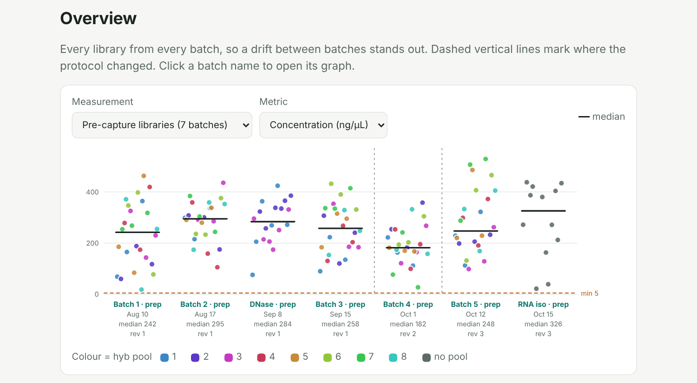

## What it does

**Runs.** A library prep and the hyb and capture that follows it are linked, so the home page shows them together with their dates from prep to sequencing. Create the hyb from a prep and its pooling plan (the µL of each library) sits at the top of the hyb's Bench tab.

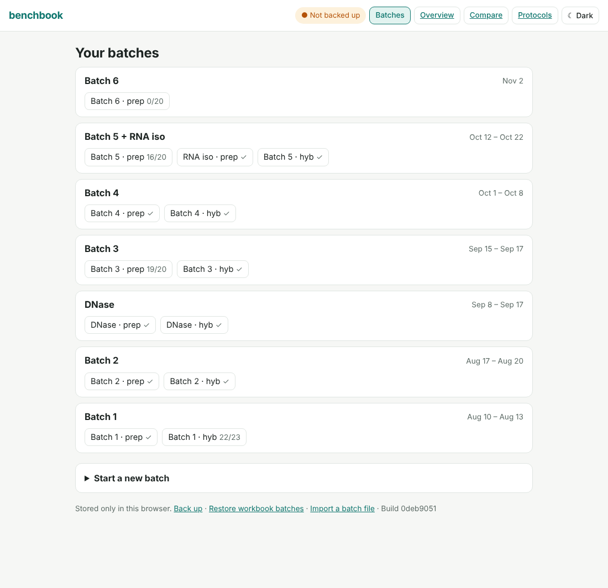

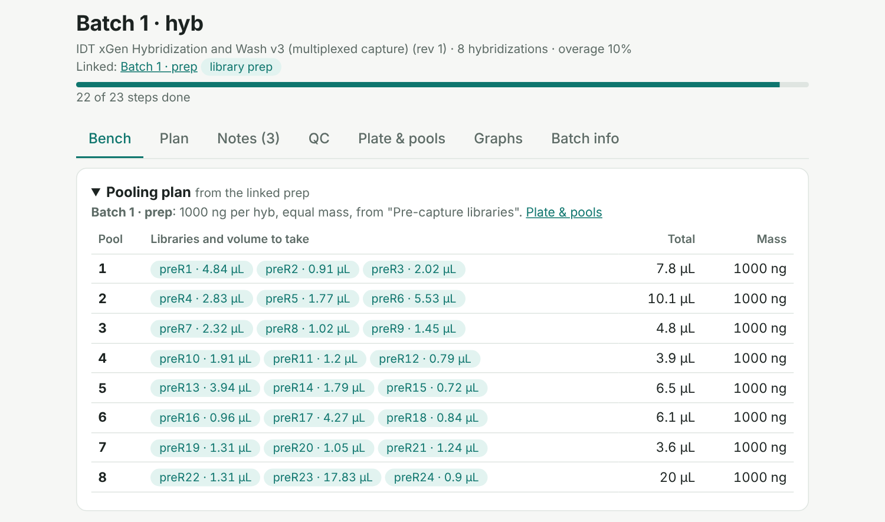

**Next batch.** One click starts a new batch like an earlier one: same protocol, overage and thermocycler, with the new libraries on the next free index wells. You see exactly which wells before you create it.

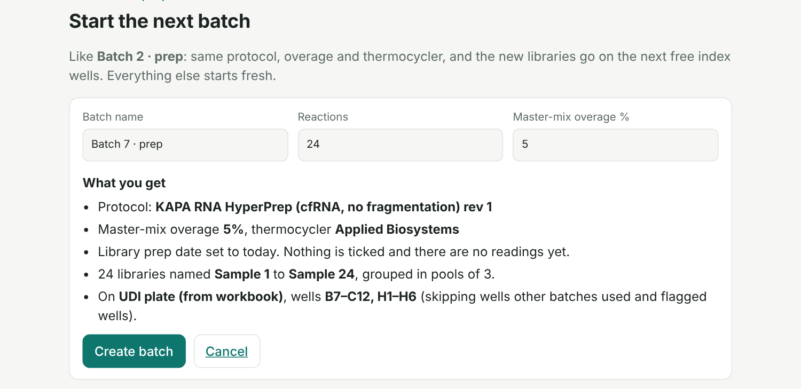

**Bench.** Enter the number of reactions and the overage, and every volume is worked out. Tick steps off, start timers for binds and incubations, add notes (observation, deviation, error, idea). Print the Plan tab as a bench sheet.

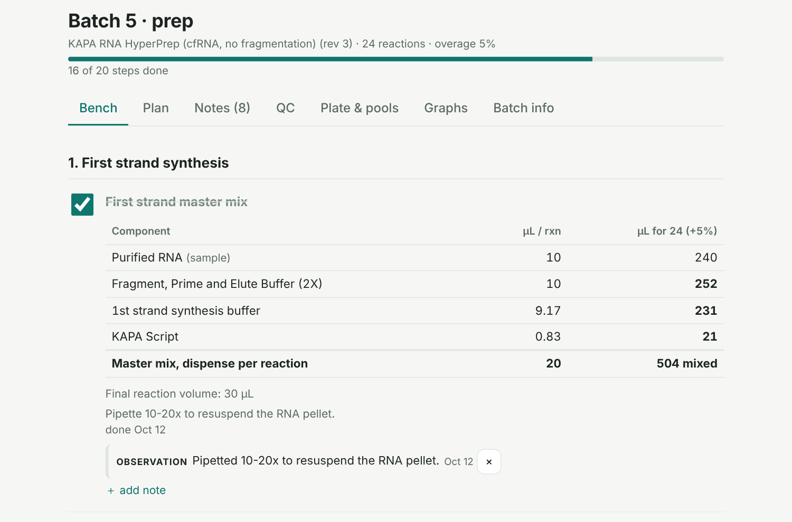

**QC and plate.** Paste NanoDrop readings (Qubit and plain two-column tables work too) and low or odd values are flagged. Lay libraries on a 96-well UDI plate (it skips wells that were used or flagged) and get the µL of each library for an equal-mass hyb pool.

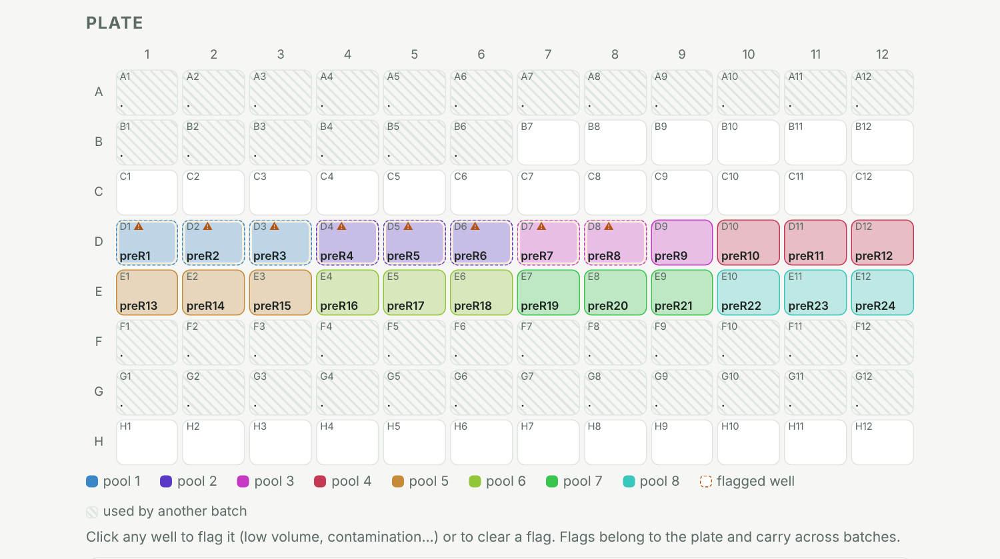

**Graphs.** One dot for every library, grouped by hyb pool. The colours are the same on the plate, in the pooling plan, on each batch's graph (a hyb's reading *n* is pool *n*) and on the Overview, and a ring marks a reading outside the QC thresholds. Batches share one scale, so they compare at a glance.

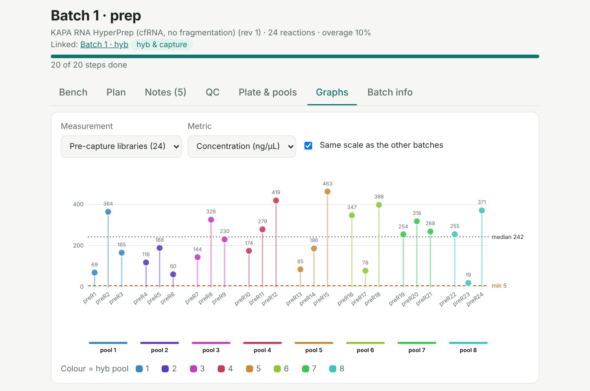

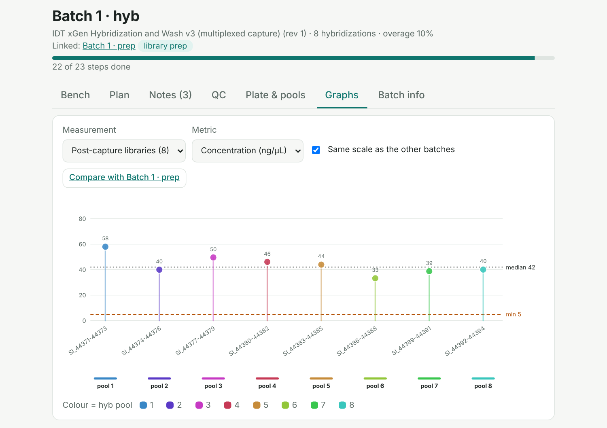

**Compare.** Pick two batches and see what changed, in plain words: settings, volumes, times, steps, QC and notes.

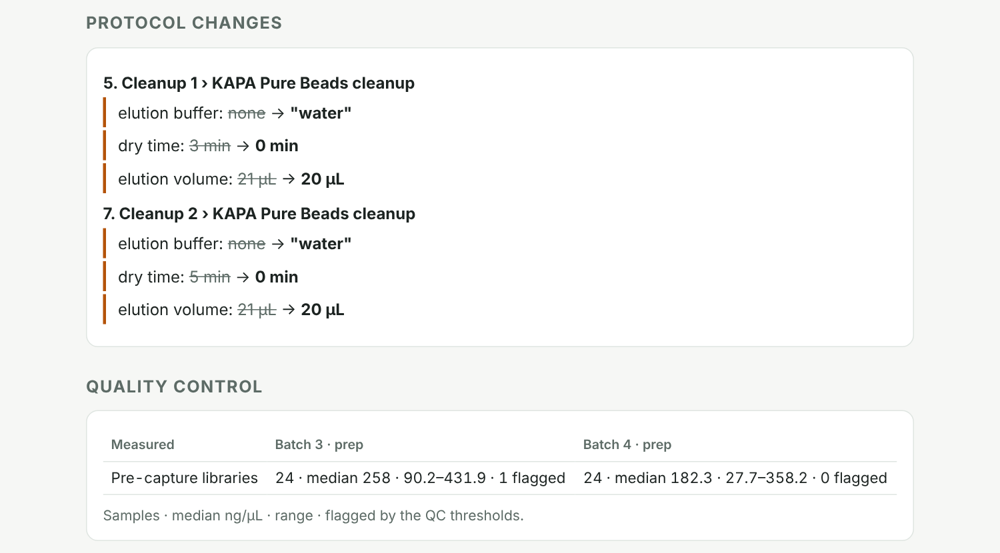

**Protocols.** Copy a built-in protocol and edit it in the page, with a live preview. Each save is a new revision, and past batches keep the revision they used.

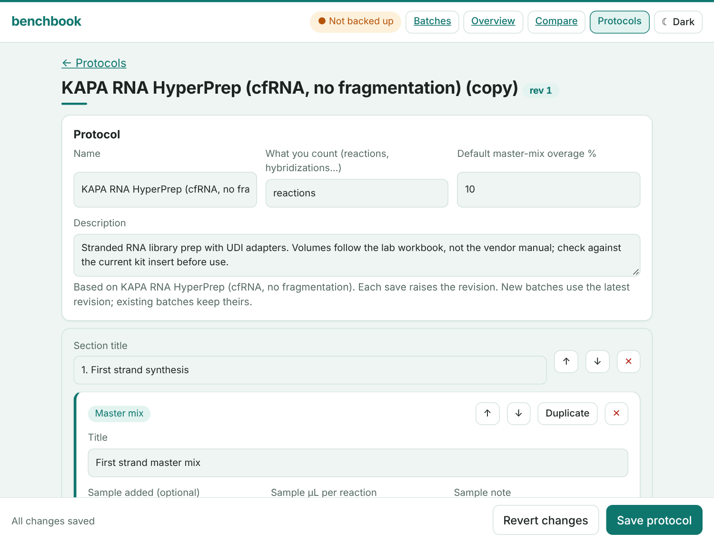

**Light and dark.** The button at the top right switches theme and remembers your choice.

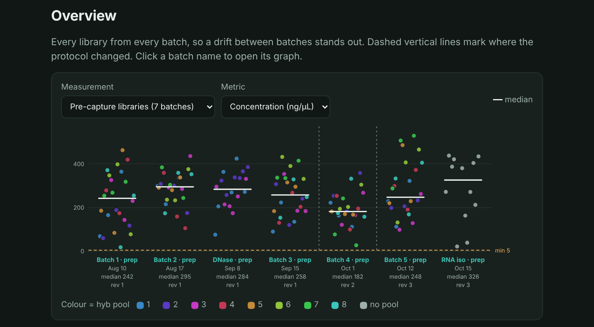

## Your data

- Everything is stored in your browser, on one device. Nothing is uploaded.
- **Back it up:** the chip at the top right shows whether you are safe. Pick a folder (Chrome or Edge) and every change is saved there, or export everything to one file.
- Deleting something shows a small **Undo** button instead of asking first.
- The 14 batches from the lab workbook are already loaded, so there is data to look at. They are normal batches: edit or delete them freely.

## Run it yourself

It is a static site with no build step. Serve the folder (browsers will not load it from `file://`):

```bash
python3 -m http.server 8000
```

then open <http://localhost:8000>. To host it, turn on GitHub Pages for the `main` branch.

## More

[docs/details.md](docs/details.md) covers backup in detail, how the workbook was imported (and the data problems found), the protocol file format, and the tests.
